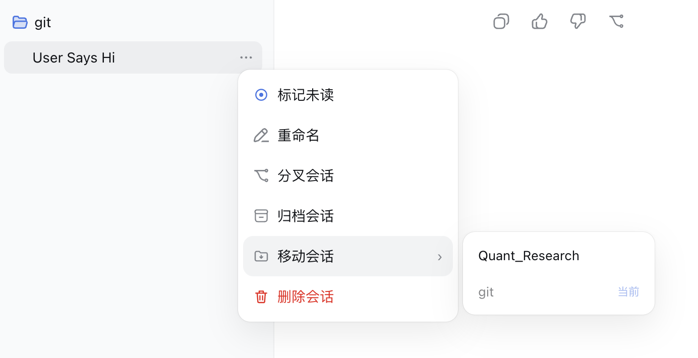
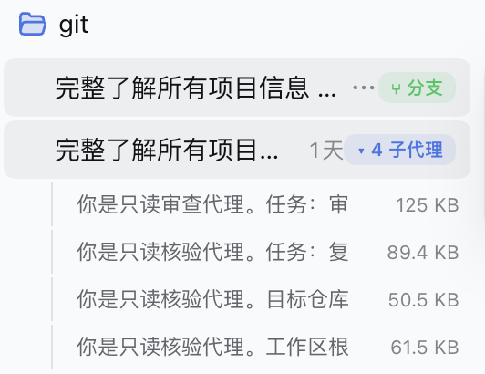
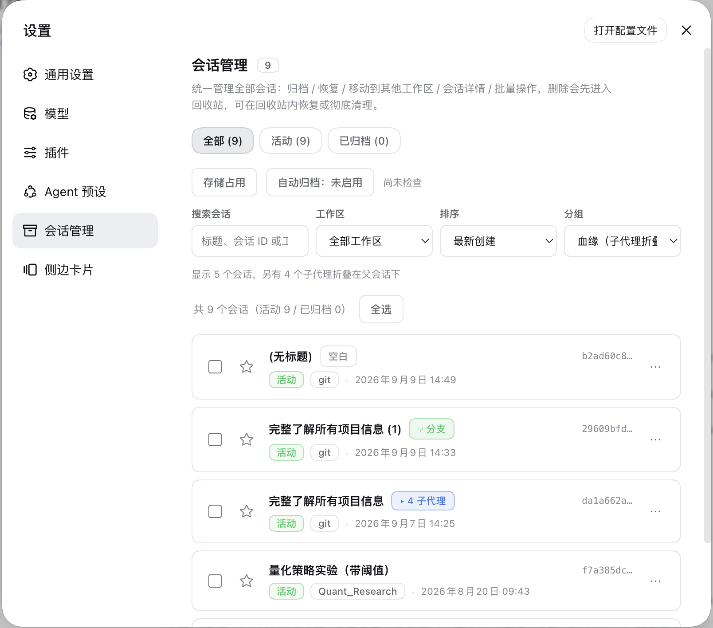
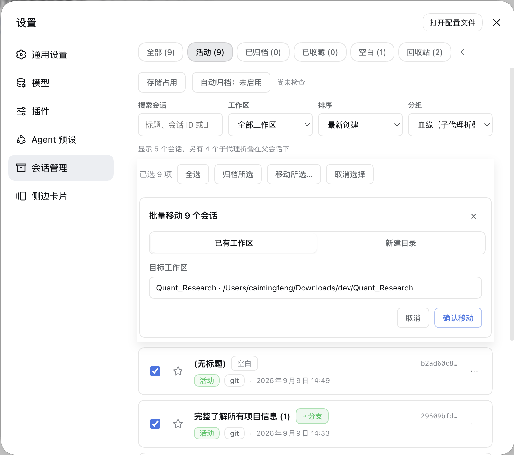
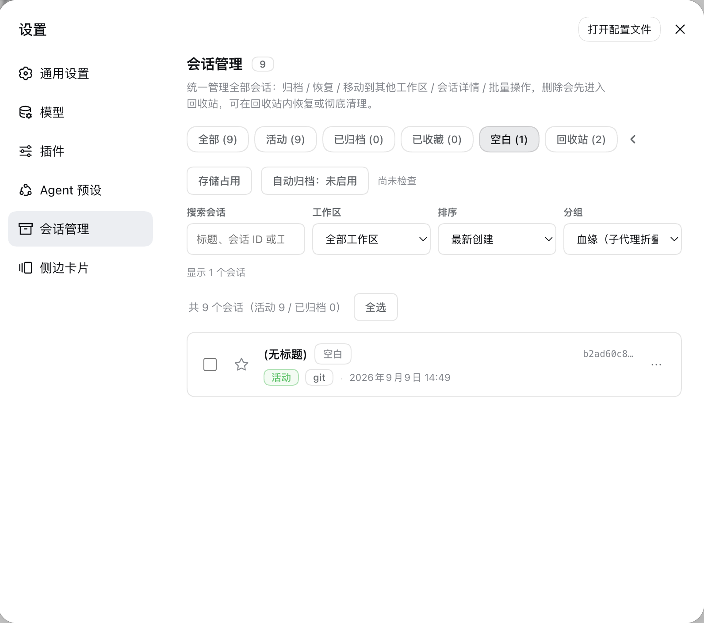
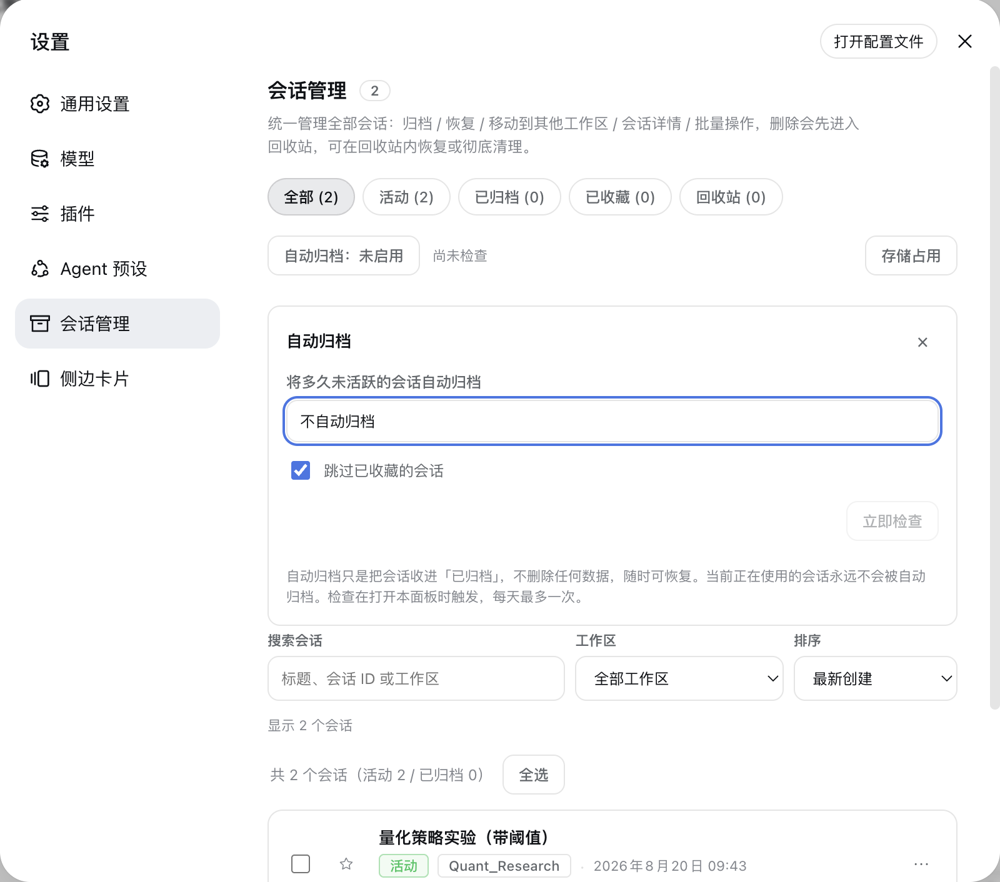
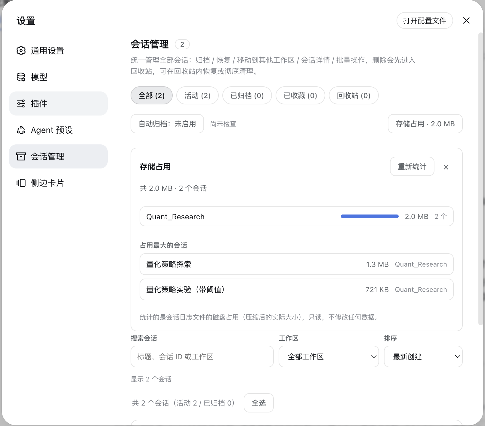
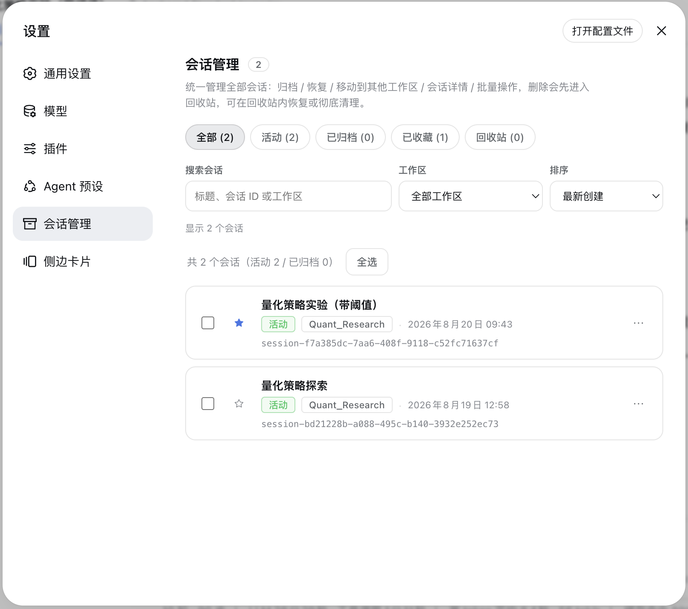
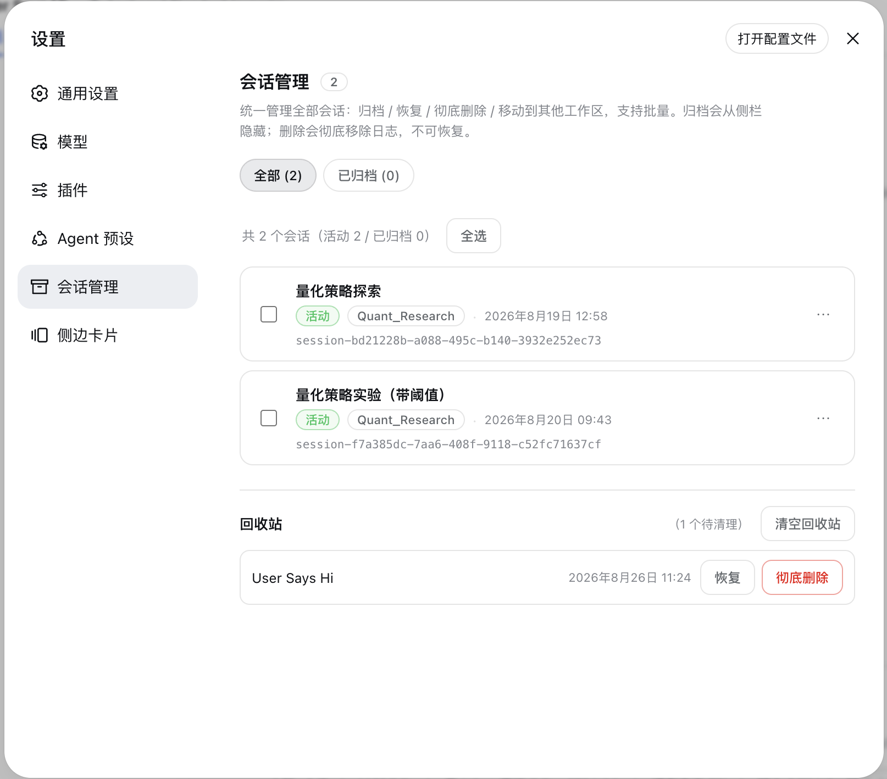
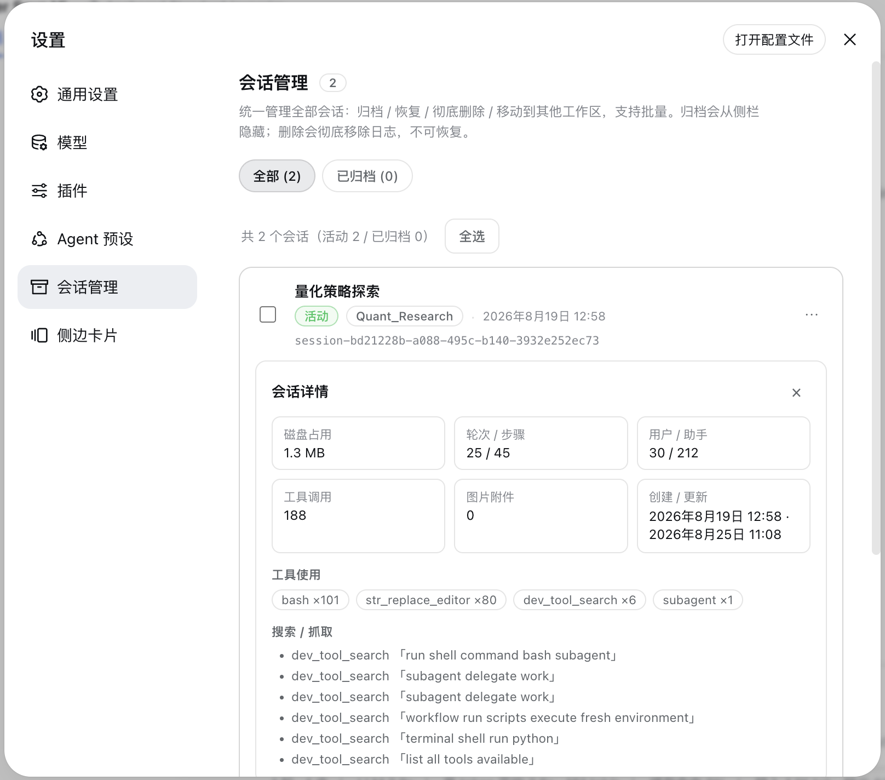

# dsh-sessions-manager

> 中文 | English


> DSH session manager: archive, move, restore and inspect sessions **and their lineage** from **Settings → 会话管理**, and mark unread / move / delete sessions straight from the **main sidebar's session ⋯ menu**. Deletes go to the recycle bin first, where they can be restored or permanently purged.

A host + browser two-half plugin covering both the settings panel and the main sidebar, so high-frequency session work never requires opening Settings. Every read and write goes through the current runtime's official surface; anything that cannot be verified safely (path derivation failed, write ownership undecidable) is disabled in both the UI and the host with an explicit reason. The plugin never treats "the method exists" as behavioural compatibility, and never reports success for work it did not do.

## Features

### Settings panel: Session Manager

- **Unified panel**: three always-visible top-level views — **All / Active / Archived** — while the low-frequency ones (**Starred / Empty / Recycle bin**) are tucked behind an arrow button at the end of the filter row and slide out horizontally on click (they stay expanded automatically while a low-frequency view is selected). Search across title, session ID, and workspace, plus workspace filters and creation-time/title sorting. The result line is a single sentence such as "Showing 5 sessions, 4 more subagents folded under their parents". A maintenance row below the filters holds the **Storage usage**, **Manage tags** and **Auto-archive** tools, which expand on demand instead of taking up a view.
- **Starred sessions**: an always-visible star button on each session row toggles starring optimistically with rollback on failure; the Starred view is orthogonal to DSH's active/archived states and they stack. The star index is plugin-owned (schema v3) and never touches DSH logs; stars are cleaned up automatically when a session is permanently purged.
- **Tags & saved filters**: label sessions with custom tags (up to 200 global, 10 per session; rename, merge, delete — **deleting a tag never touches the sessions**), filter the list by tag, and save the current "view + workspace + sort + tag" combination as a preset (up to 20) for one-click reuse. Tags and presets live in plugin-owned indexes (same discipline as the star index) inside this machine's DSH data directory — they do not follow your account.
- **Cold-title synchronization**: the sidebar is corrected from the latest log-backed `session/title`, so renamed cold sessions no longer need to be opened before showing their current name. On cold starts of large stores a title that is not ready yet simply renders blank while it fills in the background — and once it arrives, **rows already on screen and the "⑂ branch" chip's tooltip update automatically**, no page rebuild needed.
- **Sidebar workspace drag-and-drop**: drag a session onto a workspace heading to move it, with a highlighted drop target, same-workspace protection, failure feedback, and the ⋯ → Move session menu retained for keyboard access. Holding the drag near the list's top or bottom edge auto-scrolls the sidebar (faster the closer you get, stopping at either end), so a workspace heading outside the viewport is still reachable.
- **Archive / Restore**: archive hides a session from the sidebar; restore unarchives it and puts it back into its original workspace group.
- **Move to a workspace**: pick an **existing workspace**, or enter a **new directory path** (auto-created); the new-path mode also lets you open the **native OS directory picker** with a 「浏览…」 button. The session's working directory and log are migrated together. A session DSH has open (the agent loop holds its log write ownership) is never moved by force — the move is **queued automatically** and completes once the session is released; see "Moving an active session (queued moves)" below.
- **Session details**: expand any session to see **disk usage**, **turns / steps / user·assistant messages / tool calls / image attachments** stats, **tool-usage breakdown**, **search·fetch records**, the **write/edit file list** (already filtered for paths that no longer exist on disk), and **lineage** (parent session / child sessions / subagents).
- **Lineage disclosure**: the panel's **Grouping** select offers **Lineage (folded groups, default)** and **Flat (all inline)** views. Under lineage grouping, subagent sessions fold under their parents ("▸ N 子代理"), and sessions forked from the same source are **gathered into branch groups** ("▸ N 分支", oldest first by creation time; the source row stays in place, and if the parent is filtered out / archived / deleted the group degrades to a "来源：<短 ID>" header — no row is ever lost, so branches of an archived parent do hang under a "source" header in the Active view by design). Grouping lives in the panel; the sidebar only badges rows (React-owned DOM, never reordered). Subagent sessions likewise never occupy top-level rows: under lineage grouping they are excluded from the **All / Active / Archived / Empty** counts and from select-all, and only exist as the parent row's "N 子代理". Subagents whose parent is not in the current list (deleted / archived / filtered out) are collected into a single **"未归属的子代理会话"** card at the end of the list (collapsed by default; expand to open / archive / delete each of them — a search hit auto-expands it), instead of flooding the list with untitled rows. Switching to **Flat** keeps parity with native DSH: subagents sit inline and can be selected individually. Fork sessions also carry the green **"⑂ 分支"** badge (hover shows the source parent; the title is late-arriving data and refreshes itself), and empty sessions carry a gray badge with a dedicated **Empty** view for reviewing and cleaning them up.
- **Empty-session detection**: uses an **event-type method** — since `0.1.3` the log header grew and every creation writes a lifecycle-metadata frame, so the old size threshold no longer holds. The plugin decodes candidates through the official API and marks one empty only when no content event exists beyond the header (decode failures fall back to non-empty). **Plugin-injected context does not count as content**: an `agent/inbox/spliced` event that only inserts messages whose `source.kind` starts with `plugin:` or whose `form` is `'instructions'`, and removed nothing, still leaves the session empty (real user messages and unrecognised payloads still count). Detection runs entirely off the data-return path: sidebar data answers on the first tick, emptiness starts as "unknown" (unknown is never hidden and never counted as empty), a small background queue decides, and the verdict is persisted across restarts.
- **Export**: the detail panel offers two actions — "**Download raw log (ZIP)**" goes straight to DSH's official `session.export` endpoint (subsessions + attachments included, hidden automatically when the persistence backend lacks raw-artifact support); "**Export Markdown**" renders the session into a human-readable transcript (front matter + per-turn sections + user / assistant / tool-call summaries, with no streaming-delta duplication).
- **Storage analysis**: a **Storage usage** button in the maintenance row expands on demand to aggregate per-workspace disk usage of session logs (share bars + session counts) and list the Top 10 largest sessions. Read-only statistics that never modify any data; collapsed by default, so nothing is scanned until you open it.
- **Auto-archive**: optionally move sessions that have been **inactive for 30 / 60 / 90 days** into **Archived**, **off by default**. The session you are currently using and any starred session (that guard can be turned off) are never auto-archived; it only sets an archived flag and never deletes data, so recovery is always one click away. The check is lazily triggered when you open the panel, at most once per day, and can also be run manually with "Check now".
- **Batch multi-select**: select-all / archive selected / restore selected / delete selected (one confirmation for batch delete). **Select-all only covers rows that actually render and can be checked one by one** — folded subagents, gathered branch members and "source" headers are excluded, so nothing invisible is ever selected; batch delete cascades to subagents the same way and says how many it carried along. Once anything is selected, the batch action bar **pins to the top** of the panel (sticky), so a long list never forces you to scroll back up to act; a **"Move selected…"** action adds batch cross-workspace moves (reusing the single-move sheet: existing workspace / new directory / native directory picker). One failing session never blocks the rest — failures are reported one by one.

### Main sidebar: session ⋯ menu augmentation

Three additions sit between DSH's own items, ordered by increasing risk (pin / rename / fork / copy Session ID / archive stay native):

- **Mark unread** (top of the menu): adds a 「标记未读 / 标记已读」 toggle; the mark is cleared automatically when you open the session. The manual-unread blue dot itself is also clickable to clear it.
- **Move session** (after Archive): opens a hover submenu to the right listing workspace names; choose one to move the session there. The current workspace is labeled "当前" and disabled.
- **Delete session** (last, in red): moves the session into the **recycle bin** (not an immediate physical delete); restore or purge it from the Session Manager panel.

> Since `0.2.2` the menu is portalled by the host, so walking up the DOM no longer reaches the session row. The plugin registers through the official `ctx.contextMenus.register({ target: 'session' })` — the session id comes from the host and nothing depends on DOM shape. On `0.1.7`–`0.2.1`, where that service is absent, it falls back to DOM injection automatically.

### Main sidebar: subagent folding and branch badges

- **Subagent folding**: DSH's upstream sidebar intentionally never renders subagent rows, so the plugin injects them **in place** under their parent session using the official lineage fields (`origin: 'subagent'` / `parentSession` / `delegationDepth`). A **"▸ N 子代理"** badge appears when the parent row is selected or hovered; clicking it expands the indented subagent rows, and clicking a row opens that subagent via the official API. The folded list shrinks as soon as a subagent is deleted.
- **Branch badges**: sessions created by forking a parent show a green **"⑂ 分支"** (branch) chip when their row is selected or hovered, hinting at their lineage.
- **Empty sessions**: the upstream sidebar doesn't render empty sessions, so the plugin hides them too as the fixed default; managing them lives in the panel's **Empty** view.

### Main sidebar: status dots

The status dot is handed back to DSH's native `StateDot`: running (buffering ring), awaiting input (amber), completed-unread (green) and error (red) are all rendered by DSH itself. The plugin no longer repaints them or hides the native dot, so the shape/animation layer of information is preserved.

The plugin only adds the one semantic DSH doesn't have:

| Dot | State | Description |
|---|---|---|
| 🔵 Blue | Manually marked unread | Set from the ⋯ menu; auto-cleared when the session is opened, or cleared by clicking the blue dot itself |

While the manual-unread mark is set, the blue dot occupies the same status slot (the native dot steps aside); it returns as soon as the mark is cleared.

### Recycle bin

- The **Recycle bin** is a dedicated Session Manager view with item counts and deletion dates.
- Normally deleted sessions land in the recycle bin first; they are **not removed from disk immediately**, and they won't be grouped under "未分组".
- Deletion is a **soft delete**: the log stays in its original workspace directory and the recycle bin only records an index entry. To make DSH's own ledger converge as well, deleting also **writes the session into DSH's native archive** — so even with this plugin disabled or removed, those sessions never reappear in the active list (they remain in DSH's Archived). Restoring puts back the pre-delete state symmetrically.
- Inside the recycle bin you can **restore** a session (back to its original workspace) or **permanently delete** it (physically remove the log). Both verify that the log really exists on disk first: when the recorded path disagrees with the generation actually present, the path is repaired from disk; when the target is genuinely gone, or a file survives the unlink, the call fails with an explicit error and **keeps the entry** — never "success" while the file is still there.
- **Deleting a parent session takes its subagents with it**: the whole subagent subtree moves to the recycle bin by default (subagent lifetime follows the parent), and the delete dialog can opt out to keep them. Restoring or purging the parent cascades the same way, so no parentless orphan is left in the recycle bin — while a subagent you deleted on its own is never re-adopted by its parent (restoring the parent will not bring it back).
- **Empty recycle bin** removes all items at once.
- Keep items forever (default) or automatically purge them after 7 / 30 / 90 days, and verify that their log files are intact.
- The recycle-bin index uses a versioned schema, serialized mutations, and atomic writes; legacy array indexes migrate automatically.
- Permanently deleted sessions stay hidden forever and won't reappear in the sidebar or session list.
- Permanent deletion writes a host-side tombstone first, waits for the live Session and persistence controller to retire, removes the log, and rebuilds workspace indexes, preventing stale indexes, reconnects, or an empty Ungrouped section from resurfacing.

### Moving an active session (queued moves)

Every session log has a **single-writer lock**: once a session is open in DSH (even just selected as the current conversation) the agent loop owns its write handle. **The host exposes no "close session" action and no way to release that ownership — it is released only when the DSH process exits** (switching away does not release it, and empirically neither does idle waiting). Forcing the move at that point is dangerous: the live writer keeps appending to the old file and re-materialises a shell at the old path.

So held-open sessions get **deferred (queued) moves**:

- The request does not fail; the move is recorded in a pending queue (`~/.dsh/sessions-manager/pending-moves.json`) and the plugin reports **"queued" honestly** — it never claims "moved" for a move that did not happen.
- The queue runs automatically **immediately after plugin startup and retries densely** (0 / 1 / 3 / 6 / 12 / 30 s — it must win the race against the browser opening sessions), then on a light 2-minute fallback, and whenever the host releases a session.
- Up to 50 entries are kept; an entry that fails 5 times for **non-lock** reasons is dropped and logged (failures within the first 30 s after startup do not count, so a startup race cannot silently drop your queue).
- Inspect / cancel: `POST /archived-sessions/pending-moves`, `POST /archived-sessions/pending-moves/cancel { sessionIds }`; while the queue is non-empty the panel also shows a **Pending moves queue** section with per-entry cancel.
- **Results are no longer silent**: a background completion or a final give-up (5 consecutive non-lock failures) becomes a persisted notice, surfaced as a toast the next time a DSH page is open (give-ups include the reason). Notices stay on the server until acknowledged (up to 20, at most 7 days) — closing the page before the toast never loses one.
- **To actually move an active session**: request the move (it queues), then **restart DSH and don't open that session first** — it completes a few seconds after startup. Pending entries survive restarts.

### Session formats v3 / v4

DSH 0.1.5 upgrades the session log format to **v3**, and 0.1.7 upgrades it again to **v4**; the runtime performs the migration itself while reading:

- Migration is **automatic** and **keeps the original files** — so one session directory legitimately holds multiple generations side by side (`session.jsonl.zstd` next to higher generations). This plugin always reads the **highest generation actually present on disk**, matching the runtime.
- Migration is **one-way, with no downgrade read**: after opening sessions on a newer runtime, rolling the runtime back makes those sessions unreadable. Back up `~/.dsh/sessions` before a rollback.
- Only **supported** old logs are migrated; unknown events or corrupted data are **refused without any repair**. Such sessions surface as `SessionFormatUnsupportedMigrationError` / `SessionFormatError` on read/move — the plugin cannot repair them and reports the error verbatim.
- **Newly created sessions strictly require the current (v4) header**: cross-workspace moves re-sample the session header against the current backend's format, so sessions created in older formats (v3 and earlier) can be moved again and the relocated copy lands directly on the current format.
- The current format version is **probed dynamically** from the backend's format catalog package (never hardcoded), so `0.1.7` and `0.2.x` share one code path.

## Screenshots

<details>
<summary>Expand for screenshots (sidebar menu / sidebar subagent folding / settings panel / batch move / empty view / auto-archive / storage usage / starred / recycle bin / session details)</summary>





















</details>

## Install

```sh
# Option 1: npm (recommended — no clone needed; restart DSH to apply)
dsh plugin --profile desktop add dsh-sessions-manager

# Option 2: install as a Git dependency (tracks the latest commit on main)
dsh plugin --profile desktop add "github:TOBYCAI/dsh-sessions-manager"

# Option 3: local link (for development)
git clone https://github.com/TOBYCAI/dsh-sessions-manager.git
dsh plugin --profile desktop add link:/path/to/dsh-sessions-manager
```

> After installing, **restart DSH** (or refresh the page to reload the bundle). Then Settings → 会话管理 and the sidebar ⋯ menu become available.
> If you also use `dsh web`, run the same command with `--profile web`.

## Uninstall

```sh
dsh plugin --profile desktop remove dsh-sessions-manager
dsh plugin --profile web remove dsh-sessions-manager
```

> Uninstalling never deletes any session log. Sessions deleted through this plugin remain in DSH's Archived section and can be restored from DSH.

## Structure

```
package.json        npm metadata + dsh.bundle.patch + dsh.client (browser-half registration)
cordis.patch.yml    inserts this plugin's row into the profile bundle
build.mjs           esbuild build script (emits lib/, reproducible build stamp)
lib/index.js        prebuilt host (ESM)
lib/client.js       prebuilt client (ModuleLoader CJS handshake)

src/index.js               host entry: /archived-sessions/* routes, archive / recycle-bin / move orchestration
src/compat/capabilities.js capability probe (decides which operations a persistence generation allows)
src/compat/persistence.js  persistence adapter: stat the official locate() result first, derive from disk otherwise
src/handle-era-ops.js      SessionHandle-era operations (archive / move / permanent delete)
src/handle-era-paths.js    guarded path derivation (root → directory layout → session-id ownership → highest generation)
src/path-guard.js          log-path ownership checks (pure)
src/active-session.js      active-session reporting (per-clientId buckets + 45s TTL)
src/pending-moves.js       queued-move store (survives restarts, retry schedule)
src/move-notices.js        retention and acknowledgement of queued-move outcome notices
src/auto-archive.js        auto-archive settings (schema v4) + the pure candidate rule
src/storage-stats.js       storage usage aggregation (pure)
src/lineage.js             lineage classification and empty-session detection (event-type method)
src/empty-scan-index.js    on-disk cache of empty-session verdicts (fingerprint + TTL gates)
src/star-index.js          starred-session index (schema v3)
src/tag-index.js           tag index (schema v4)
src/saved-filters.js       saved filter presets (schema v1)
src/title-persist-index.js small on-disk index of titles / metadata
src/session-meta-cache.js  in-memory session metadata cache (validated by log-content fingerprint)
src/markdown.js            session → human-readable Markdown
src/zstd-frame.js          zstd multi-frame scanning and rewriting
src/state-temp-sweep.js    sweeps stale temp files left by atomic writes

src/client/index.jsx       client entry: settings panel, sidebar augmentation, official slot / contextMenus registration
src/client/logic.js        unit-tested pure logic (folding, counting, filtering, drag step, …)
```

`lib/` is prebuilt, so a clone works as-is without esbuild. To change the source, run `npm i -D esbuild && npm run build` to regenerate `lib/`; before committing, run `npm run check:dist` to rebuild and diff against the committed artefacts (CI runs the same check). **Always rebuild when you bump the version** — the build stamp is the reproducible `vX.Y.Z+source-hash`, precisely so this diff stays meaningful.

## Host routes

| Method | Path | Description |
|---|---|---|
| POST | `/archived-sessions/sessions` | List every session (with archived flags) for the Session Manager panel |
| POST | `/archived-sessions/list` | List archived sessions (skipping deleted / missing ones) |
| POST | `/archived-sessions/archive` | Archive (hide) a single session |
| POST | `/archived-sessions/archive-many` | Batch archive |
| POST | `/archived-sessions/restore` | Unarchive one session |
| POST | `/archived-sessions/restore-many` | Batch unarchive |
| POST | `/archived-sessions/delete` | Delete one session — **into the recycle bin** (not an immediate physical delete) and into DSH's native archive; cascades the whole subagent subtree by default (`cascadeSubagents: false` keeps them), returning `cascaded` / `cascadedIds` |
| POST | `/archived-sessions/delete-many` | Batch move to the recycle bin (cascades subagents, returns the total `cascaded`) |
| POST | `/archived-sessions/trash/list` | List sessions in the recycle bin |
| POST | `/archived-sessions/trash/restore` | Restore from the recycle bin (also restores the subagents that were carried along, returns `cascaded`) |
| POST | `/archived-sessions/trash/purge` | Permanently delete one recycle-bin session (cascades the same way, returns `cascaded`) |
| POST | `/archived-sessions/trash/purge-many` | Empty / batch-purge recycle-bin sessions (cascades by parent) |
| POST | `/archived-sessions/trash/settings` | Read or update the retention policy `{ retentionDays }` (0 / 7 / 30 / 90) |
| POST | `/archived-sessions/trash/verify` | Verify that recycle-bin logs still exist |
| POST | `/archived-sessions/workspaces` | List candidate target workspaces |
| POST | `/archived-sessions/move` | Move a session to a target workspace `{ sessionId, targetPath }`; returns `{ queued: true }` and enqueues when DSH holds the session open |
| POST | `/archived-sessions/move-many` | Batch cross-workspace move `{ sessionIds, targetPath }` — one failure never blocks the rest, failures are reported per session, held-open sessions land in `queued`, and indexes are rebuilt once at the end |
| POST | `/archived-sessions/pending-moves` | Inspect the pending-move queue (held-open sessions are queued and complete on release) |
| POST | `/archived-sessions/pending-moves/cancel` | Cancel queued moves `{ sessionIds }` |
| POST | `/archived-sessions/pending-moves/notices/ack` | Acknowledge queued-move outcome notices (cleared after display; unacknowledged items are kept up to 7 days) |
| POST | `/archived-sessions/details` | Session details (disk / stats / tools / fetch / files / lineage) `{ sessionId }` |
| POST | `/archived-sessions/sidebar-state` | Authoritative titles, recycle-bin ids, purge tombstones, **lineage classification** (subagent / branch / empty flags), `warmPending` / `refinePending` (whether the title-warmup and empty-detection queues are still in flight), and `moveNotices` (queued-move outcomes; omitted when empty) |
| POST | `/archived-sessions/lineage-tree` | Recursive subagent tree (data source for panel grouping and sidebar folding), already filtered against the recycle bin and tombstones |
| POST | `/archived-sessions/star/set` | Star / unstar `{ sessionId or sessionIds, starred }` |
| POST | `/archived-sessions/tags/list` | Tag definitions + session→tag assignments `{ tags, assignments }` |
| POST | `/archived-sessions/tags/create` | Create a tag `{ name }` (rejects duplicates / over 200, error carries a code) |
| POST | `/archived-sessions/tags/rename` | Rename `{ id, name }` (id is stable) |
| POST | `/archived-sessions/tags/merge` | Merge into another tag `{ fromId, toId }` (deduplicated; the source tag disappears) |
| POST | `/archived-sessions/tags/delete` | Delete a tag `{ id }` (definition and assignments only — never sessions) |
| POST | `/archived-sessions/tags/set` | Replace a session's tags `{ sessionId, tagIds }` |
| POST | `/archived-sessions/filters/list` / `save` / `delete` | Saved filter presets `{ name, filters }` (≤20; `filters` is an opaque payload) |
| GET | `/archived-sessions/export-md?sessionId=` | Single-session Markdown export (human-readable transcript) |
| POST | `/archived-sessions/storage` | Storage aggregation (per-workspace ranking + largest sessions) `{ topN }` |
| POST | `/archived-sessions/auto-archive/settings` | Read or update the auto-archive policy `{ inactiveDays, skipStarred }`; reading lazily triggers the daily check |
| POST | `/archived-sessions/auto-archive/run` | Run the auto-archive check once, ignoring the daily throttle |
| POST | `/archived-sessions/capabilities` | Current persistence generation, read / archive / recycle-bin / purge / cross-workspace-move capabilities, plus two client echoes: `clientMenu: { mode, at }` (menu channel, `contextMenus` or `dom`) and `clientUi: { navSection, navIcons, navOwn, navFallback, navIconRenders, sessionRows, workspaceRows, overflowRows, stateDots, tokenBgLayer2, tokenWarn, at }` (UI self-evidence: counts and resolved token values only, never titles or message bodies) |

> Deleting a session moves it to the recycle bin by default; only "permanently delete" inside the recycle bin physically removes the log. Permanently deleted sessions are hidden forever on the client side so they don't reappear in the sidebar or "ungrouped" due to DSH runtime caching.

## Compatibility

- **Platforms**: macOS / Windows / Linux — anything DSH runs on. The host is built as Node ESM targeting `node22`; the browser half is React. Neither depends on OS-specific APIs.
- Works on both DSH Desktop and `dsh web` (same host + client).
- See `package.json` for peerDependencies; `react` and `@deepseek-ai/*` are provided by the DSH runtime.

| Runtime | Status | Key adaptations |
|---|---|---|
| `0.2.2-rc.3` | verified | The left-nav icon uses the official `settings.section.icon` slot (no more second glyph drawn by a CSS mask); menu resolution is synchronous with a pre-warmed snapshot (rc.3 gives async `resolve` a 1 s budget); duplicate registration guarded (rc.3 throws on the same id twice); design tokens point at the current names (`bg-layer-1/2` …); blank detection covers the 0.2.2 state events |
| `0.2.2-rc.1` | verified | Session menu moved to the official `contextMenus` data registration; delete also writes the native archive flag; `inject` keeps only packages that really exist |
| `0.2.1-rc.2` | verified | Session format still v4; persistence became a cordis plugin (both shapes mount); sidebar wraps rows, folded counts calibrated from `sessionCount`; the empty-group container is the role-less `groupSection` |
| `0.2.0-rc.1` / `0.2.0-rc.2` | verified | `ctx.sessions` became a data-stream service, opening a session goes through `uiWorkspace.openSession`; peer ranges widened to `>=0.1.0-rc.6`; storage domain is domain-data shaped; the active session is reported by the client heartbeat |
| `0.1.7-rc.2` | verified | Session format v4, format catalog split into its own package; moves re-sample the header against the backend format |
| `0.1.5` / `0.1.3` / `0.1.2` | verified | Older runtimes only enable operations that can be verified safely — see below |

> Unverified future runtimes get only the safely recognisable subset; the plugin never treats "the method exists" as behavioural compatibility. The panel's own messages and the `/archived-sessions/capabilities` payload are authoritative.

### Behaviour differences and degradations

- **Recycle-bin restore verifies first**: restore confirms the underlying session still exists (live / `stat` / list, three levels). It returns an accurate error when the session is gone (`DSM_SESSION_MISSING`), already purged (`DSM_SESSION_PURGED`), or the index still lists it while its log has vanished (`DSM_SESSION_LOG_MISSING`); when the log location cannot be verified it says `unverified` instead of pretending the check passed. Restoring into a deleted workspace succeeds and notes that the session is temporarily "ungrouped".
- **Permanent delete / empty recycle bin / automatic purge**: the official contract exposes no delete API, so the plugin keeps the legacy half-official route — **three guarded derivations** from the backend instance's storage root (root → session-directory layout → session-id ownership check), then removes the directory and re-checks it with the official `stat`; sessions with active writes are refused (409). When derivation fails (e.g. the storage root cannot be established) the capability is disabled with a reason — never a blind delete. Sibling generations in the same directory are removed too, otherwise DSH falls back to an older generation and the delete is effectively a no-op.
- **Cross-workspace move**: the primary path is official `create` + `append` event replay (a write-ownership probe refuses sessions DSH holds for writing, revision checks bracket the write, and a backup rollback guarantees no half-moved state); when the backend carries a same-id ghost record it falls back to rewriting the frame-0 cwd (frame count and content verified byte for byte). Paths come from the same guarded derivation; the workspace group index is rebuilt after the move, no restart needed. Because the runtime enforces "one project directory per session id", a move is a **whole-directory relocation**: the source directory is moved aside first (invisible to official scanning), the target is replayed and verified, and only then is the source removed — superseded generations left in other project directories are reclaimed along the way so a session never gets stuck as a cross-directory duplicate.
- **Purge tombstones don't suppress new sessions**: if a session with the same id is recreated, the tombstone steps aside and the new session appears normally.
- **Metadata caching**: change detection uses the official snapshot `revision` on newer runtimes (comparable within one process only, never written to a cross-restart cache file) and a `(mtime, size)` fingerprint on older ones. List cwd / creation time come straight from the snapshot header, no log read; titles are not read at page load either — a missing title renders blank first and is filled in from a background queue. **Read failures and "this session truly has no title" are kept strictly apart**: a failure writes no cache and is retried later (immediately once that session's log changes), so one transient failure never leaves a session permanently "(untitled)".
- **Auto-archive**: newer runtimes expose no reliable "last active" signal, so when idleness cannot be proven the check is skipped (`no-activity-data`) rather than guessing.
- **Sidebar injection**: DOM / React-fiber recognition is confined to a versionable adapter; when the upstream sidebar shape is not recognised the whole augmentation disables safely without affecting the official sidebar. When recognised it runs mostly on incremental MutationObserver updates with a low-frequency fallback sweep.
- **Lineage disclosure**: subagent sessions are recognised from official header fields (`origin: 'subagent'`, `parentSession`, `delegationDepth`); the upstream sidebar renders neither subagent rows nor empty sessions, so the plugin injects subagent rows under their parents and hides empty ones. Emptiness uses the **event-type method** — session creation always writes a lifecycle-metadata frame (`permission/preset` / `sandbox/mode` / `approval/policy`), which invalidates size thresholds; candidates go through official decoding and only a session with no content event beyond the header is judged empty, with decode failures falling back to non-empty. Verdicts are cached per session against a restart-stable size fingerprint (only genuinely decoded verdicts persist), so an unchanged log is never re-read; detection runs on its own small background queue that yields between batches, keeping the data path decode-free.

## License

[MIT](./LICENSE) © TOBYCAI
