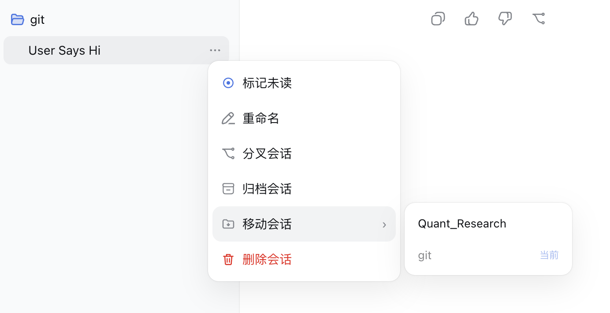
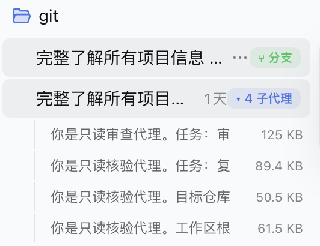
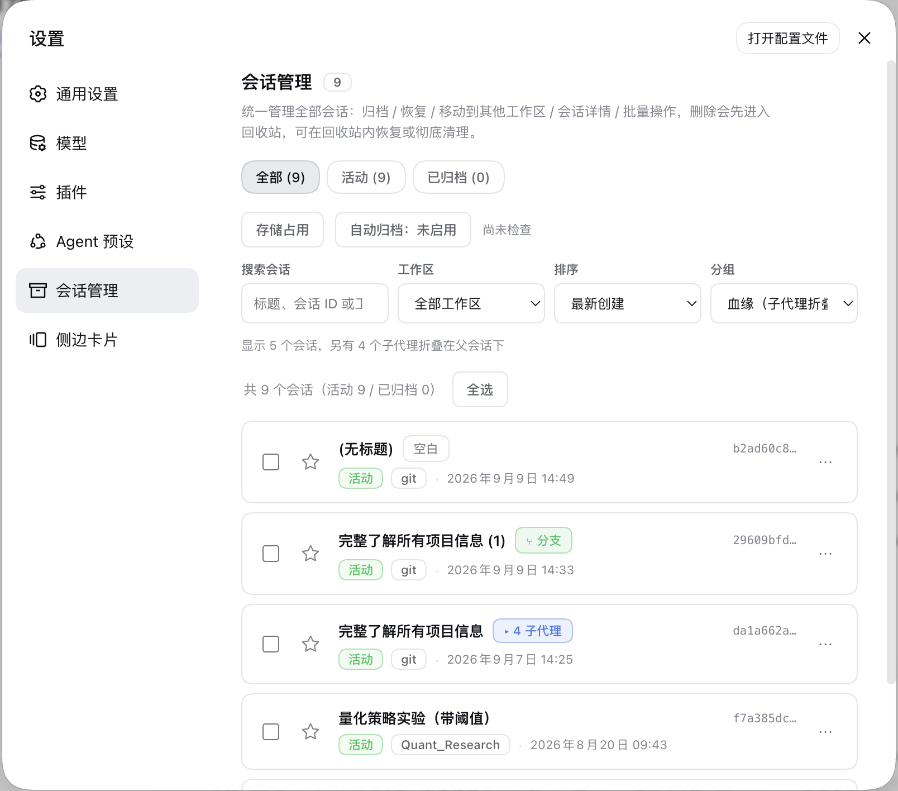
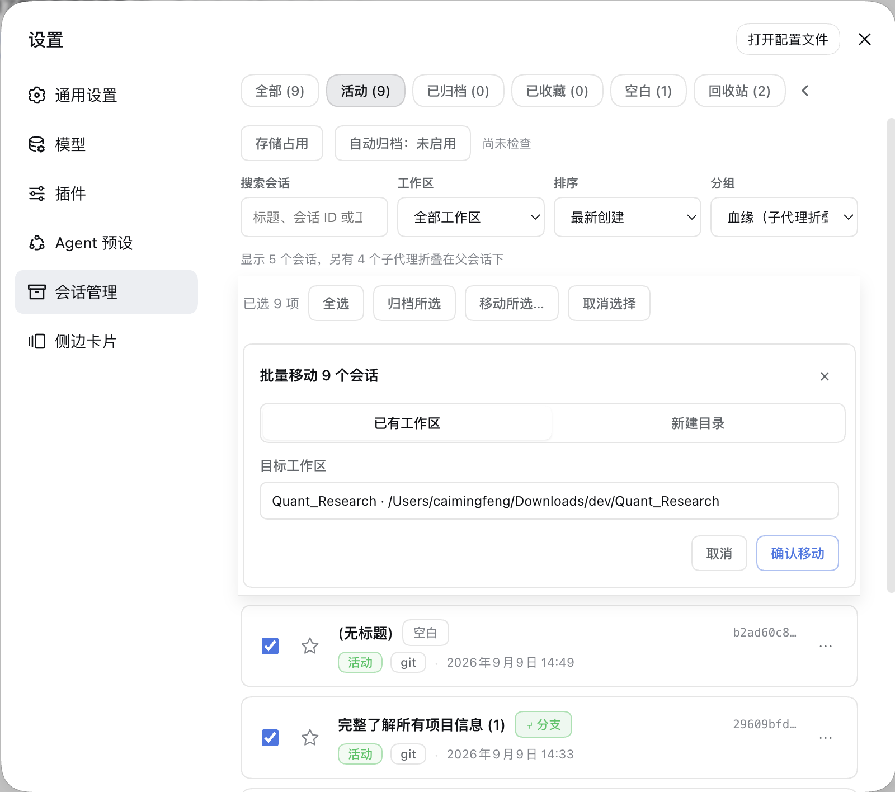
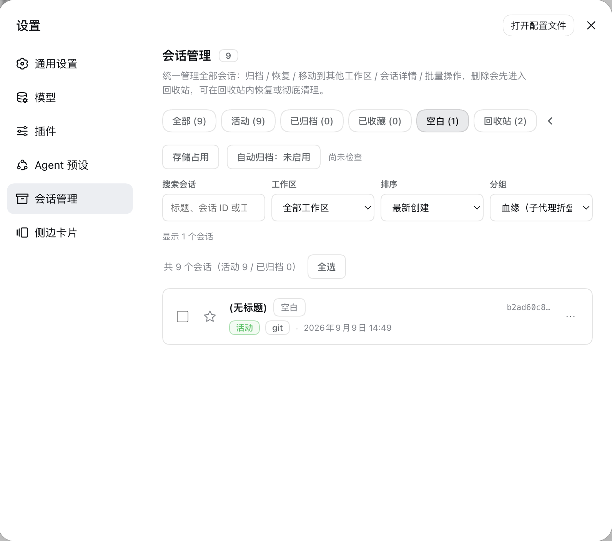
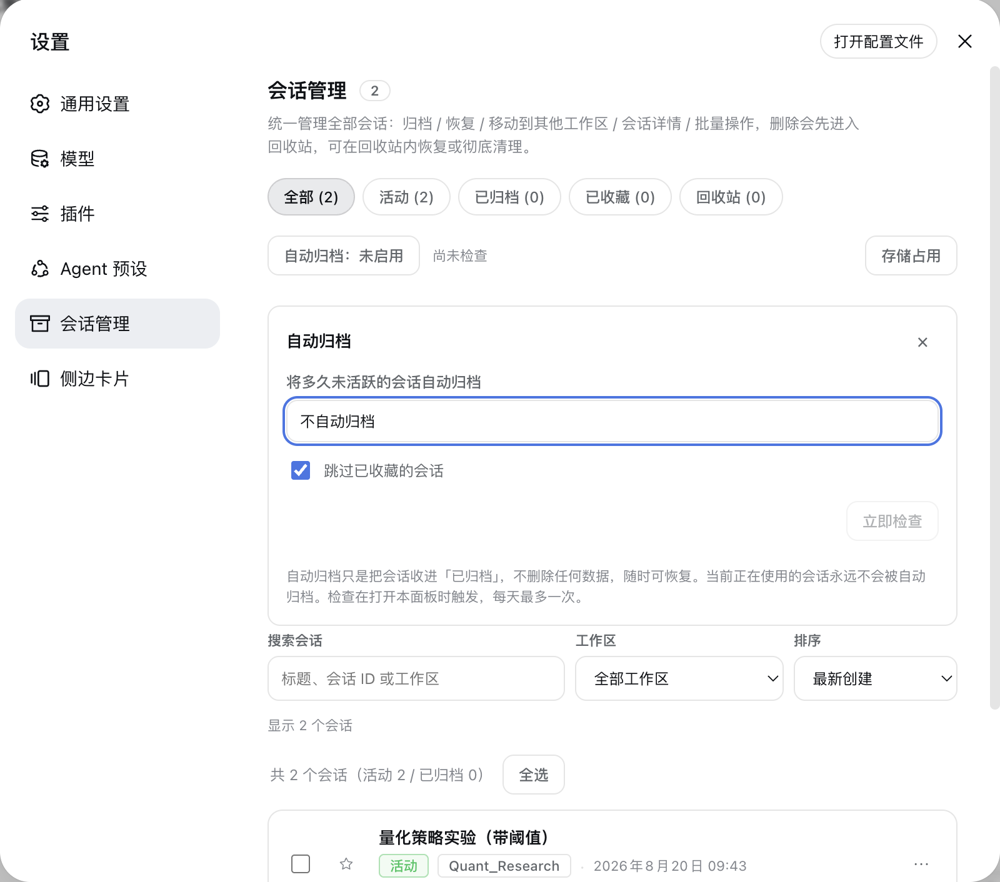
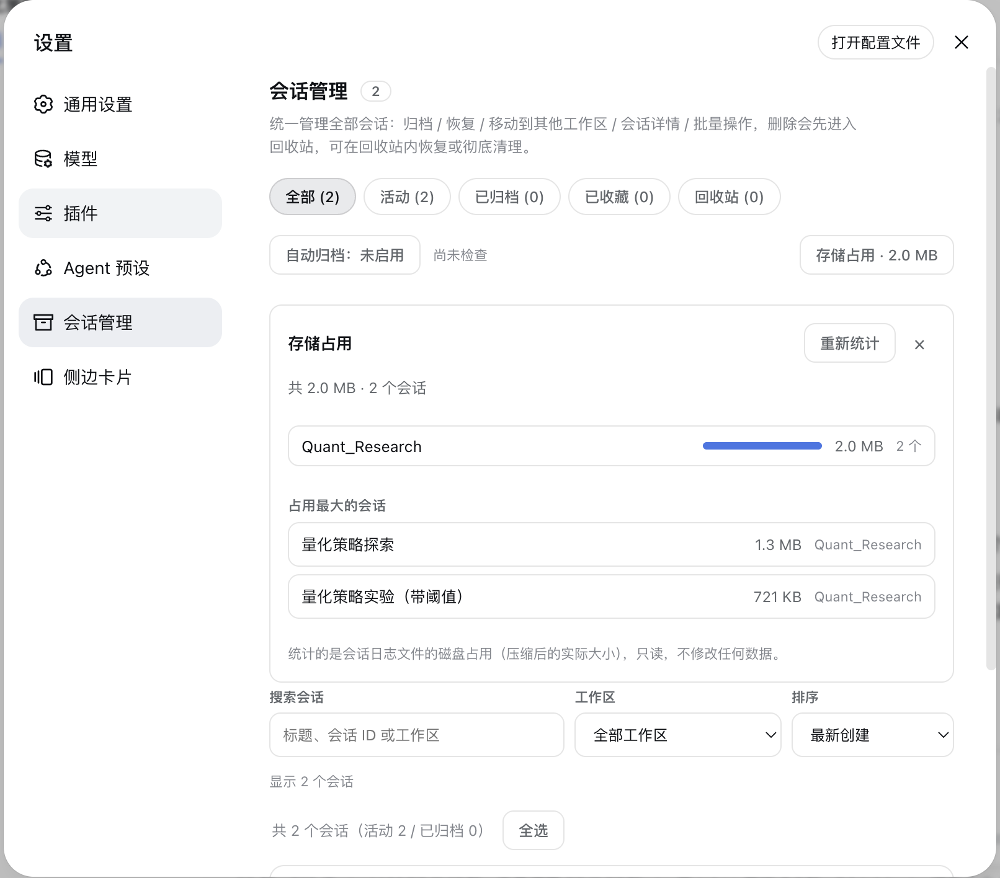
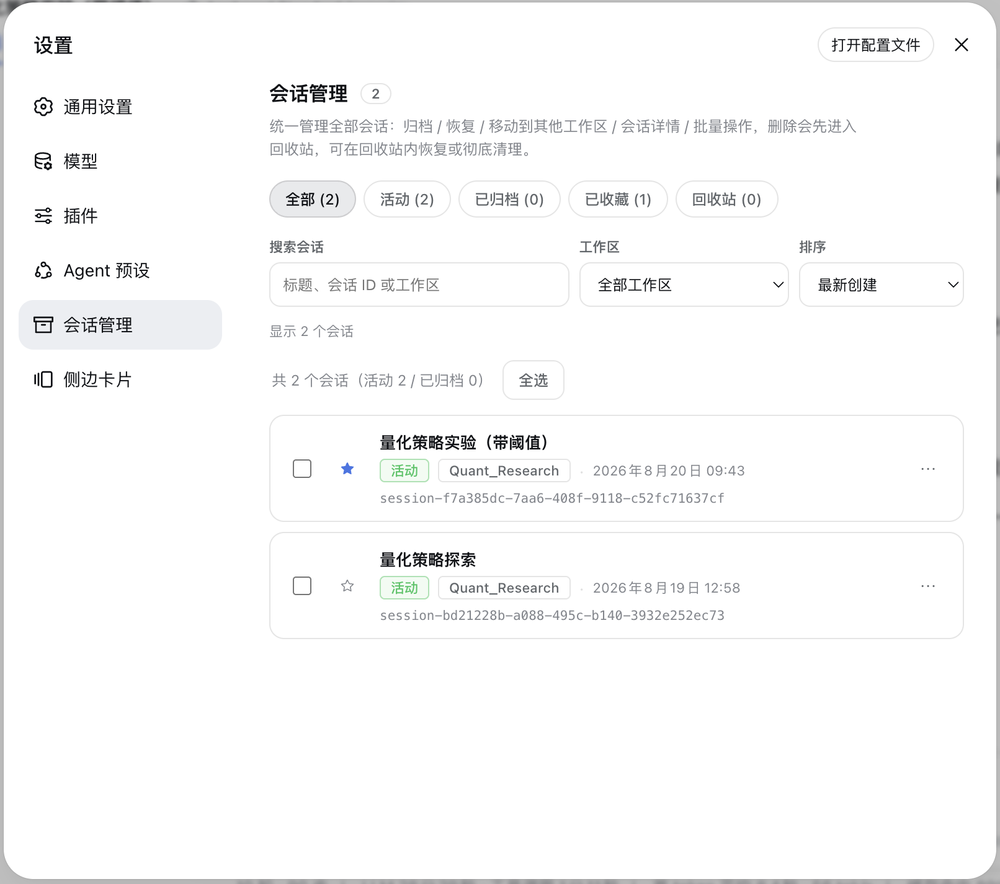
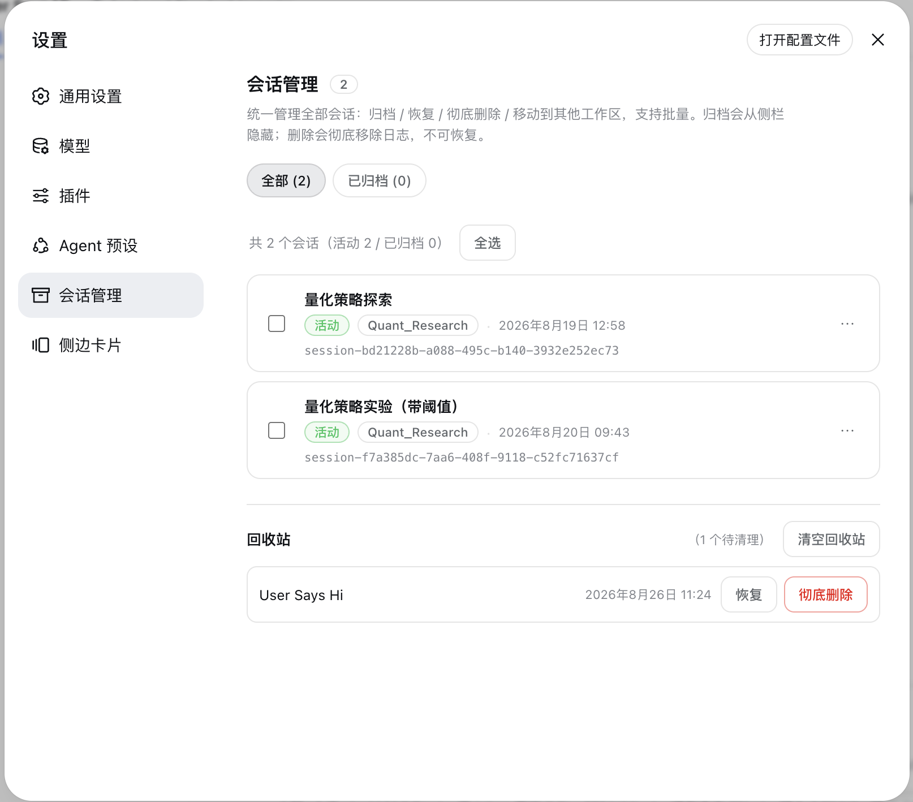
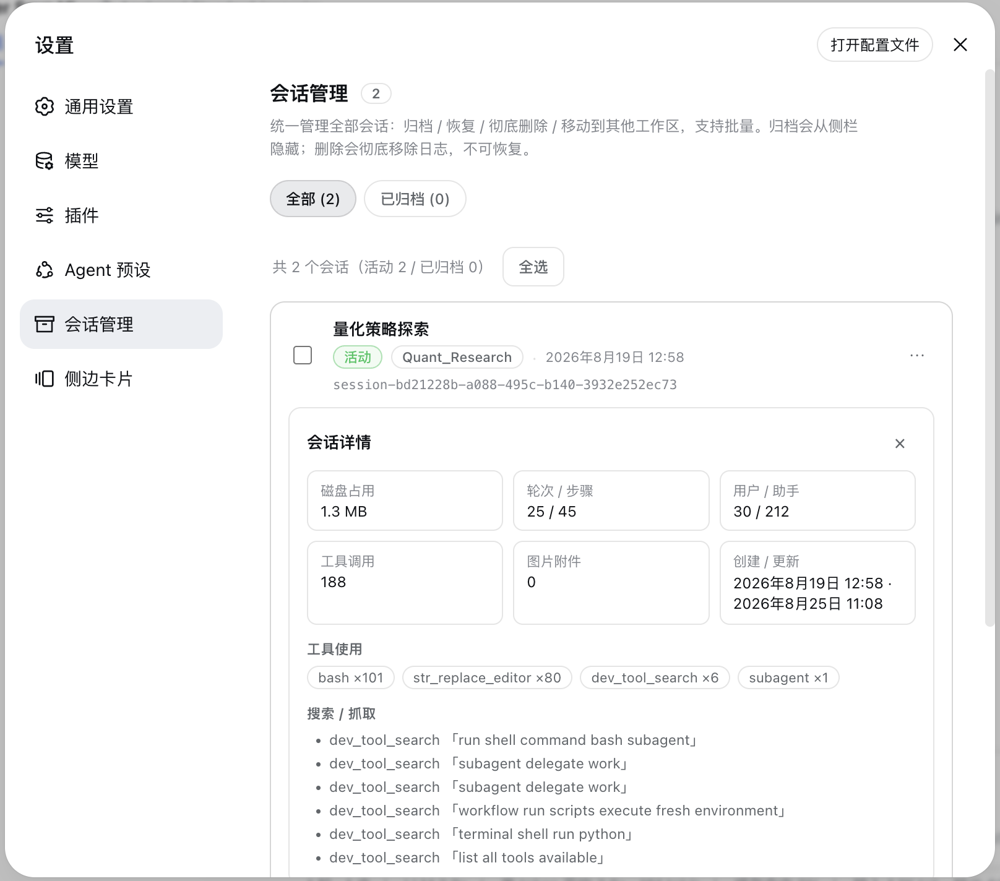

# dsh-sessions-manager

> 中文 | [English](./README.en.md)


DSH 的会话只有一个收尾动作：归档。删不掉、搬不走、看不出谁是谁派生的，也不知道哪个早就想不起来的历史会话在悄悄占着几百兆磁盘。

这个插件把这几件事补上。设置里多一个面板，侧栏会话行的 ⋯ 菜单多三项。删除先进回收站，误删能捞回来；跨工作区移动不用再重开一个会话；子代理和 fork 分支终于能看见；空白会话可以集中清掉。读写全部走 DSH 官方接口，不 fork 也不改官方源码。

## 安装

```sh
dsh plugin --profile desktop add dsh-sessions-manager
```

装完重启 DSH。然后「设置 → 会话管理」，以及侧栏会话行的 ⋯ 菜单，就在那儿了。

另外两种装法：

```sh
# 跟随 main 最新提交
dsh plugin --profile desktop add "github:TOBYCAI/dsh-sessions-manager"

# 本地改代码时（clone 后 link 进去）
git clone https://github.com/TOBYCAI/dsh-sessions-manager.git
dsh plugin --profile desktop add link:/path/to/dsh-sessions-manager
```

如果你也用 `dsh web`，把 `--profile desktop` 换成 `--profile web` 再来一遍。

卸载用 `dsh plugin --profile desktop remove dsh-sessions-manager`，不会动任何会话日志。被这个插件删过的会话仍躺在 DSH 的「已归档」里，可以在 DSH 侧恢复。

## 会多出什么

| 位置 | 多了什么 |
|---|---|
| 侧栏会话行的 ⋯ 菜单 | 标记未读、移动会话、删除会话 |
| 侧栏父会话行 | 「▸ N 子代理」折叠、绿色「⑂ 分支」标记 |
| 设置 → 会话管理 | 全部会话的列表、搜索、筛选、详情、批量操作 |
| 同上 → 回收站 | 删掉的会话，可恢复或彻底清理 |

## 侧边栏

### ⋯ 菜单

三项，按危险程度插在 DSH 自己的菜单项之间——置顶、重命名、分叉、复制 Session ID、归档都还是官方那套。

- **标记未读**（最上面）。切过去之后状态点变蓝，回到这个会话时自动清掉。蓝点本身也能点，点了就取消。
- **移动会话**（归档下面）。右边弹出工作区列表，选一个就走。当前所在的工作区标着「当前」，点不动。
- **删除会话**（最下面，红字）。进回收站，不立即物理删除。

`0.2.2` 开始菜单由宿主用 portal 渲染，沿 DOM 往上已经摸不到会话行了。所以这里走官方 `ctx.contextMenus.register({ target: 'session' })`，会话 ID 由宿主直接给出，不依赖任何 DOM 形状。`0.1.7`–`0.2.1` 没有这个服务，退回 DOM 注入。

### 拖到别的工作区

除了菜单，也可以直接把会话行拖到目标工作区的标题上，松手就切过去。目标会高亮，拖回原工作区会被拦下，失败有反馈。

拖到侧栏列表的上下边缘会自动滚动，越靠边越快，到顶到底就停——所以视口外的工作区标题也够得着。

### 子代理与分支

DSH 侧栏按设计不显示子代理行。插件按官方头部字段（`origin: 'subagent'`、`parentSession`、`delegationDepth`）把子代理行插到父会话下面：父行被选中或鼠标悬停时冒出「▸ N 子代理」，点开是缩进的子行，点一下就用官方 API 打开那个子代理会话。子代理被删掉后，折叠列表跟着收敛。

fork 出来的会话带绿色「⑂ 分支」标记，悬停能看到来源父会话。

侧栏只打标记，不重排。这些行由官方 React 托管，重排整棵树会跟它对不上。要看成组的树，去设置面板。

### 冷启动时的标题

侧栏标题不靠现读日志。`0.2.2` 起先问官方的持久投影缓存——只读会话头，零磁盘 I/O，没打开过的历史会话也能直接拿到标题。缓存里没有就先留空，后台分批补齐；补上之后，屏幕上已经渲染的行和「⑂ 分支」的悬停说明会自己更新，不用等页面重建。旧 runtime 上则用日志里最新的 `session/title` 修正，改名后同样不必先打开。

### 状态点

运行中、等你接管、完成未读、出错，这四个状态点还是 DSH 自己画的（`StateDot`），插件不重画也不遮。只补了一个 DSH 没有的语义：

| 圆点 | 状态 | 说明 |
|---|---|---|
| 🔵 蓝 | 手动标记未读 | 通过 ⋯ 菜单标记；进入会话后自动清除，也可直接点蓝点取消 |

蓝点出现时占的是同一个状态槽，原生点临时让位；取消标记后立刻回来。

## 设置面板

### 查看与搜索

顶部三个常驻视图：全部、活动、已归档。已收藏、空白、回收站收在行尾的箭头按钮里，点一下横向滑出——常用的站外面，不常用的收起来。低频视图处于选中态时会一直展开。

搜索框认标题、会话 ID 和工作区名。工作区下拉里除了真实工作区，还有两项特殊的：「未分组」收没有工作区的会话，「工作区已删」收工作区目录已经不在了的会话，面板上的同名 chip 是同一个意思。排序按创建时间或标题。

列表上方只有一句话说明现在看到的是什么，比如「显示 5 个会话，另有 4 个子代理折叠在父会话下」。

筛选栏下面还有一排维护用的按钮：存储占用、标签管理、自动归档。点开才占地方，平时不挡路。

### 会话详情

点开单条会话，能看到：

- 磁盘占用
- 轮次、步骤、用户 / 助手消息数、工具调用数、图片附件数
- 工具使用分布
- 搜索与抓取记录
- write / edit 写过的文件（磁盘上已经不存在的路径会过滤掉）
- 血缘：父会话、子会话、子代理

底部两个导出入口。「下载原始日志 (ZIP)」直接走官方 `session.export`，含子会话与附件，后端不支持时按钮不显示；「导出 Markdown」由插件把会话渲染成能读的对话记录——front matter、按轮分节、用户 / 助手 / 工具调用摘要，流式增量不会重复。

### 血缘分组

顶部「分组」下拉有两个选项：

- **血缘**（默认）：子代理折叠到父会话下面，同一来源 fork 出来的分支聚成一组「▸ N 分支」。
- **平铺**：跟 DSH 原生一致，子代理逐行并列，可以单独勾选。

血缘视图下有几条规则值得先知道：

- 分支组内按创建时间升序，来源父行留在原位。
- 父会话被筛掉、归档或删掉时，组头降级成「来源：<短 ID>」，一行都不会丢。所以「活动」视图里出现「来源：」组头是正常的，不是 bug。
- 子代理不占顶层行，不计入「全部 / 活动 / 已归档 / 空白」的计数，也不参与全选。
- 父会话不在当前列表里的子代理，统一收进列表末尾的「未归属的子代理会话」卡片，默认收起，搜索命中会自动展开。不会拿一堆「(无标题)」行把列表铺满。

### 批量

勾选之后能批量归档、恢复、删除、移动。归档的会话从侧栏消失，恢复的会放回原工作区分组。

操作栏吸顶钉在面板顶部，列表再长也不用滑回上面。

全选只覆盖当前真正占一行、能单独勾选的会话——折叠中的子代理、聚拢的分支成员、「来源：」组头都不在内，避免选中界面上根本看不见的东西。批量删除按父会话级联子代理，确认框会写明连带几个。

「移动所选…」复用单条移动的面板：已有工作区、新建目录、系统目录浏览都行。一条失败不影响其它，失败明细逐条回报。

### 星标、标签、筛选预设

星标是会话行左侧的常驻按钮，单击收藏或取消，先改界面再落盘，失败回滚。「已收藏」是独立视图，跟活动 / 归档状态叠加——归档的会话照样能收藏。

标签用来做你自己的分类，全局最多 200 个，单个会话最多 10 个，支持重命名和合并。删除标签只删标签和它的归属关系，不碰会话本身。

「视图 + 工作区 + 排序 + 标签」这一套可以存成预设，最多 20 条，下次一键还原。

这三样都存在插件自己的索引里（本机 DSH 数据目录下），不跟账号走，换台机器不会同步过去。会话被彻底删除时，对应的星标和标签归属会自动清掉。

### 存储占用与自动归档

**存储占用**按工作区聚合会话日志占了多少磁盘，带占比条和会话数，再列出最占地方的 10 个会话。纯只读，默认收起，点开才统计，所以不会拖慢列表。

**自动归档**可以把 30 / 60 / 90 天没动过的会话收进「已归档」，默认关闭。当前正在用的会话和已收藏的会话不会被归档（收藏这条保护可以关掉）。它只打归档标记，不删数据，随时能恢复。检查在打开面板时顺带触发，每天最多一次，也可以点「立即检查」。

## 回收站

删除是软删除：日志还留在原工作区目录里，回收站只记一条索引，列表上标着待清理数量和删除时间。

有个副作用容易让人意外——删除的同时，插件会把会话写进 **DSH 自己的归档**。这样即使你停用或卸载了插件，这些会话也不会重新冒回活动列表，它们老老实实待在 DSH 的「已归档」里。恢复时按删除前的状态对称还原。

回收站里能做的事：

- **恢复**：回到原工作区。
- **彻底删除**：物理清理日志。
- **删父会话会连带子代理**：默认把整棵子树一起收进来（子代理的生命周期本来就跟父会话走），确认框里可以取消勾选保留它们。恢复或彻底删除父会话时同样级联，不会在回收站里留下没爹的孤儿。你自己单独删掉的子代理不会被父会话重新认领。
- **清空回收站**：一次全清。保留策略默认永久，也可以设 7 / 30 / 90 天自动清理，另有日志完整性校验。

恢复和彻底删除都会先确认文件真的在盘上：索引记的路径和磁盘实际代际不一致时按实际文件纠偏；目标确实不在，或者删完复核发现文件还在，都返回明确错误并**保留条目**，不会出现「说成功了但文件还在」。

回收站索引是版本化 schema，变更串行、原子写入，旧版的数组索引会自动迁移。彻底删除会先落一个墓碑，等 live Session 和持久化控制器退出、移除日志、重建工作区索引——所以即使重连、或者宿主还拿着旧索引，也不会让它重新出现，或者生成一个空的「未分组」。

## 两个不太直观的行为

### 搬一个正在用的会话

DSH 给每个会话日志加了单写者锁。会话一旦被打开（哪怕只是选中它），写所有权就归 agent-loop 了。官方没有「关闭会话」这个入口，这个所有权只在 DSH 进程退出时释放——切走不释放，干等着也不释放。

这时候硬搬很危险：写者会继续往旧文件写，还会在旧路径上重建一个空壳目录。

所以被占用的会话走排队：

- 移动请求不会失败，会话进队列（`~/.dsh/sessions-manager/pending-moves.json`），界面如实说「已排队」。
- 插件启动后立刻密集重试（0、1、3、6、12、30 秒），必须抢在浏览器打开那些会话之前；之后每 2 分钟兜底一次，宿主释放会话时也会触发。
- 队列最多 50 条。同一条连续 5 次因为**非占用**原因失败，就放弃并记日志；启动后 30 秒内的失败不计入，免得启动竞态把队列丢掉。
- 队列非空时，面板上有个「待移动队列」小节，可以逐条取消。
- 后台搬完或者最终放弃，都会落成通知，下次打开 DSH 页面时弹出来（放弃的带原因）。通知在服务端留到你确认，最多 20 条、最长 7 天，没弹出来也不会丢。

真要搬一个正在用的会话：先发起移动让它进队列，然后重启 DSH，**先别打开那个会话**。启动后几秒内它就搬完了。没完成的项跨重启还在。

### 什么样的会话算空白

`0.1.3` 之后日志头部扩容，而且新建会话时必定先写一帧生命周期元数据，所以按体积猜「有没有内容」不成立了。现在的做法是看事件类型：对候选会话走官方解码，头部之外没有任何内容事件才算空白。解码失败按非空处理——宁可多留一个，也不误删。

有一类情况要单独说：**插件注入的上下文不算内容**。`agent/inbox/spliced` 如果只插入了 `source.kind` 以 `plugin:` 开头的消息、或者 `form: 'instructions'` 的消息，并且没删掉任何消息，这个会话仍然算空白。真正的用户消息，以及认不出来的载荷，照旧算内容。

判断不挡数据：侧栏数据首拍就返回，空白与否先按「未知」处理（未知不隐藏，也不计入空白），后台小队列逐条判，结论落盘跨重启复用，后面的拍自动收敛。

侧栏的空白行由插件隐藏，但**当前会话那一条永远不隐藏**——刚建的对话必须能在侧栏看见。上游只过滤它已知是空白、且不是当前会话的行；对没有投影缓存记录的冷会话，上游按「未知 = 非空」处理，剩下的这层由插件补。管理空白会话去面板的「空白」视图。

## 截图

<details>
<summary>展开查看截图（侧边栏菜单 / 侧栏子代理折叠 / 设置面板 / 批量移动 / 空白视图 / 自动归档 / 存储占用 / 已收藏 / 回收站 / 会话详情）</summary>





















</details>

## 已知限制

- **活跃会话搬不走，得重启。** 上游不释放写所有权，只能排队等进程退出，没有别的办法。
- **回滚 runtime 会让升级后打开过的会话读不了。** 日志迁移是单向的，退回旧版本就没有解码能力了。回滚前先备份 `~/.dsh/sessions`。迁移会保留原文件，所以同一个会话目录里同时躺着 `session.jsonl.zstd` 和更高代的 `session.vN.jsonl.zstd` 是正常的，插件按磁盘上实际存在的最高代读。
- **损坏的旧日志修不了。** 官方只迁移受支持的旧日志，遇到未知事件或损坏数据会拒绝迁移，也不做修复。这类会话在插件里表现为 `SessionFormatUnsupportedMigrationError` 或 `SessionFormatError`，插件没有代修能力，只能照实报。
- **侧栏不重排。** 子代理行只是插进去，不会重新排整棵树，理由见上文。
- **空白判定偏保守。** 解码失败的按非空算，所以「空白」视图里可能漏掉几个实际空着的会话。这是有意的。
- **删除会写进 DSH 原生归档。** 为了让 DSH 自己的账本也跟着收敛，卸载插件后会话不会复活。真想让它彻底消失，去回收站「彻底删除」。
- **星标、标签、预设跟机器走。** 存在本机 DSH 数据目录里，不同步到账号。
- **老 runtime 能力更少。** `0.1.5` 及更早的运行时只开放能安全验证的操作，其余在面板上标出来并说明原因。

## 兼容性

DSH Desktop 和 `dsh web` 都能用，同一套 host + client。macOS / Windows / Linux 都行，只要 DSH 能在上面跑——host 按 `node22` 打成 Node ESM，浏览器端是 React，不依赖特定操作系统的 API。

| Runtime | 状态 | 这版做了什么 |
|---|---|---|
| `0.2.2-rc.3` | 已实测 | 左导航图标走官方 `settings.section.icon` 槽；菜单解析改同步 + 快照预热（rc.3 给异步 `resolve` 的预算是 1 秒）；同 id 重复注册会抛错，加了守卫；设计令牌换成现行名；空白判定补上 0.2.2 的状态类事件；冷标题读官方持久投影缓存（`sessionProjectionCache`，零 I/O），并用它的 `blank` 做单向预筛，侧栏空白行与上游对齐为「只藏非当前会话」 |
| `0.2.2-rc.1` | 已实测 | 会话菜单改官方 `contextMenus` 数据注册；删除同步写原生归档；`inject` 只留真实存在的包 |
| `0.2.1-rc.2` | 已实测 | 会话格式仍 v4；persistence 改成 cordis 插件形态（两种形态都能挂）；侧栏行包了 wrapper，折叠计数改用 `sessionCount` 校准；空分组容器变成无 role 的 `groupSection` |
| `0.2.0-rc.1` / `rc.2` | 已实测 | `ctx.sessions` 退化成数据流服务，打开会话走 `uiWorkspace.openSession`；peer 范围放宽到 `>=0.1.0-rc.6`；活跃会话改由客户端心跳上报 |
| `0.1.7-rc.2` | 已实测 | 会话格式升到 v4，格式目录拆成独立包；移动时按后端当前格式重采样会话头 |
| `0.1.5` / `0.1.3` / `0.1.2` | 已实测 | 旧代运行时只开放能安全验证的能力 |

没验证过的未来 runtime 默认只开能认出来的安全能力，以面板上的提示和 `/archived-sessions/capabilities` 的返回为准，不看方法在不在。

<details>
<summary>旧 runtime 上具体会少什么、绕在哪</summary>

- **回收站恢复**先校验底层会话还在不在（live / `stat` / 列表三级）。不在了返回 `DSM_SESSION_MISSING`，已经彻底删过是 `DSM_SESSION_PURGED`，索引还在但日志文件没了是 `DSM_SESSION_LOG_MISSING`；位置无法核实时标 `unverified`，不假装校验通过。恢复到「工作区已删除」的会话会成功，并提示它暂时归到「未分组」。
- **彻底删除 / 清空回收站 / 自动物理清理**：官方公共契约没有删除 API，走的是 legacy 时代的半官方路线——从后端实例的存储根目录字段出发做三层守卫式推导（根目录 → 会话目录结构 → 会话 ID 归属校验），通过后整目录删除，再用官方 `stat` 复核。有活跃写入的会话直接拒绝（409）。推导不出来（比如确认不了存储根目录）就禁用并说明原因，不盲删。同目录并存的多代日志会一起清掉，否则 DSH 会回退读到旧代，等于没删。
- **跨工作区移动**的主路径是官方 `create` + `append` 事件重放：写所有权探测会拒绝被 DSH 占着写的会话，revision 前后校验防并发写，备份回滚保证失败不留半移动状态。后端有同 ID 幽灵记录时，退回 frame0 cwd 改写搬运，帧数和内容逐位校验。路径同样来自守卫式推导；移动后自动重建工作区分组索引，不用重启。因为官方按「同一 ID 只能落在一个项目目录」校验，移动是整目录搬运：先把源目录整体移开（对官方扫描彻底不可见），目标侧校验成功后删源目录，顺带回收其它项目目录里被取代的旧代副本，免得同一个会话永久卡在「跨目录重复」里，动也动不了、删也删不掉。
- **彻底删除的墓碑不压制新会话。** 同 ID 会话被重新创建时，墓碑让位，新会话正常出现在列表和侧栏。
- **元数据缓存**：判断日志有没有变化，新 runtime 用官方快照的 `revision`（只在同一进程内可比，不会写进跨重启的缓存文件），旧的用 `(mtime, size)` 指纹。列表的目录和创建时间直接取快照会话头，不读日志；标题也不在页面加载时现读，缓存里没有就先留空，后台分批补上再刷出来。读取失败和「确实没有标题」是两回事：失败不写缓存，稍后重试（那种会话日志一变就立刻再试），偶发一次失败不会让会话永久挂着「（无标题）」。
- **自动归档**在新 runtime 上拿不到可靠的「最后活跃时间」，证明不了闲置就跳过（`no-activity-data`），不猜。
- **侧栏注入**的 DOM / React fiber 识别收在一个可版本化的 adapter 里。上游侧栏结构认不出来时整体安全停用，不影响官方侧栏本身。认出来时以 MutationObserver 增量驱动为主，只留低频兜底扫描。

</details>

## 开发

`lib/` 是预构建好的，clone 下来直接能用，不需要 esbuild。要改源码：

```sh
npm i -D esbuild
npm run build       # 重新生成 lib/
npm run check:dist  # 重建后与仓库产物比对（CI 跑同一道检查）
npm test
```

改版本号后必须一并重建——构建指纹是 `vX.Y.Z+源码哈希`，就是为了让这道比对精确可靠。

<details>
<summary>源码结构</summary>

```
package.json         npm 元数据 + dsh.bundle.patch + dsh.client（浏览器半注册）
cordis.patch.yml     向 profile bundle 插入本插件行
build.mjs            esbuild 构建脚本（生成 lib/，构建指纹可复现）
lib/index.js         预构建 host（ESM）
lib/client.js        预构建 client（ModuleLoader CJS handshake）

src/index.js               host 入口：/archived-sessions/* 路由、归档 / 回收站 / 移动编排
src/compat/capabilities.js 能力探测（按持久化代际决定开放哪些操作）
src/compat/persistence.js  持久化适配：官方 locate 结果先验盘，失败再按磁盘布局推导
src/handle-era-ops.js      SessionHandle 世代的操作实现（归档 / 移动 / 彻底删除）
src/handle-era-paths.js    守卫式路径推导（根目录 → 目录结构 → 会话 ID 归属 → 最高代际）
src/path-guard.js          日志路径归属校验（纯函数）
src/active-session.js      活跃会话上报（clientId 分桶 + 45s TTL）
src/pending-moves.js       排队移动队列（跨重启保留 + 重试计划）
src/move-notices.js        排队移动终局通知的保留与确认
src/auto-archive.js        自动归档设置（schema v4）+ 候选判定纯函数
src/storage-stats.js       存储占用聚合（纯函数）
src/lineage.js             血缘分类与空白会话判定（事件类型法）
src/projection-hints.js    官方持久投影缓存的冷读助手（标题 / blank 提示，零 I/O）
src/empty-scan-index.js    空白精判结论的磁盘缓存（指纹 + TTL 双闸门）
src/star-index.js          星标索引（schema v3）
src/tag-index.js           标签索引（schema v4）
src/saved-filters.js       筛选预设（schema v1）
src/title-persist-index.js 标题 / 元数据的磁盘小索引
src/session-meta-cache.js  会话元数据内存缓存（按日志内容指纹校验）
src/markdown.js            会话 → 人类可读 Markdown
src/zstd-frame.js          zstd 多帧扫描与重写
src/state-temp-sweep.js    原子写入残留临时文件清理

src/client/index.jsx       client 入口：设置面板、侧栏增强、官方 slot / contextMenus 注册
src/client/logic.js        可单测的纯逻辑（折叠、计数、筛选、拖拽步长等）
```

</details>

<details>
<summary>Host 路由</summary>

| 方法 | 路径 | 说明 |
|---|---|---|
| POST | `/archived-sessions/sessions` | 列出全部会话（含已归档标记），供「会话管理」面板 |
| POST | `/archived-sessions/list` | 列出归档会话（跳过已删除 / 不存在者） |
| POST | `/archived-sessions/archive` | 归档（隐藏）单个会话 |
| POST | `/archived-sessions/archive-many` | 批量归档 |
| POST | `/archived-sessions/restore` | 取消归档单个 |
| POST | `/archived-sessions/restore-many` | 批量取消归档 |
| POST | `/archived-sessions/delete` | 删除单个会话——**移入回收站**（非立即物理删除），同时写入 DSH 原生归档；默认连带整棵子代理子树（`cascadeSubagents: false` 可保留），返回 `cascaded` / `cascadedIds` |
| POST | `/archived-sessions/delete-many` | 批量移入回收站（按父会话级联子代理，返回 `cascaded` 总数） |
| POST | `/archived-sessions/trash/list` | 列出回收站中的会话 |
| POST | `/archived-sessions/trash/restore` | 从回收站恢复会话（连带恢复当初跟随它一起回收的子代理，返回 `cascaded`） |
| POST | `/archived-sessions/trash/purge` | 彻底删除回收站中的单个会话（连带条目同样级联，返回 `cascaded`） |
| POST | `/archived-sessions/trash/purge-many` | 清空 / 批量彻底删除回收站会话（按父会话级联） |
| POST | `/archived-sessions/trash/settings` | 读取或更新自动清理策略 `{ retentionDays }`（0 / 7 / 30 / 90） |
| POST | `/archived-sessions/trash/verify` | 校验回收站日志是否仍存在 |
| POST | `/archived-sessions/workspaces` | 列出可选目标工作区 |
| POST | `/archived-sessions/move` | 把会话移动到目标工作区 `{ sessionId, targetPath }`；目标会话正被 DSH 打开时返回 `{ queued: true }` 并登记排队 |
| POST | `/archived-sessions/move-many` | 批量跨工作区移动 `{ sessionIds, targetPath }`——单条失败不阻断，失败明细逐条回报，被占用的会话进 `queued` 列表，末尾统一重建索引 |
| POST | `/archived-sessions/pending-moves` | 查看待移动队列（会话被占用时排队，释放后自动完成） |
| POST | `/archived-sessions/pending-moves/cancel` | 取消排队 `{ sessionIds }` |
| POST | `/archived-sessions/pending-moves/notices/ack` | 确认排队移动终局通知（展示后清理；未确认项最长保留 7 天） |
| POST | `/archived-sessions/details` | 会话详情（磁盘 / 统计 / 工具 / fetch / 文件 / 血缘）`{ sessionId }` |
| POST | `/archived-sessions/sidebar-state` | 返回侧栏权威标题、回收站 ID、永久删除墓碑、**血缘分层**（子代理 / 分支 / 空白标记）、`warmPending` / `refinePending`（标题预热、空白精判两条后台队列是否仍在途）与 `moveNotices`（排队移动终局通知，空则省略字段） |
| POST | `/archived-sessions/lineage-tree` | 递归子代理树（面板血缘分组与侧栏折叠的数据源），已过滤回收站与墓碑 |
| POST | `/archived-sessions/star/set` | 收藏 / 取消收藏 `{ sessionId 或 sessionIds, starred }` |
| POST | `/archived-sessions/tags/list` | 标签定义 + 会话→标签映射 `{ tags, assignments }` |
| POST | `/archived-sessions/tags/create` | 新建标签 `{ name }`（重名 / 超 200 拒绝，错误带 code） |
| POST | `/archived-sessions/tags/rename` | 重命名 `{ id, name }`（id 不变） |
| POST | `/archived-sessions/tags/merge` | 并入 `{ fromId, toId }`（去重合并后源标签消失） |
| POST | `/archived-sessions/tags/delete` | 删除标签 `{ id }`（只删定义与映射，不碰会话） |
| POST | `/archived-sessions/tags/set` | 全量设置某会话的标签 `{ sessionId, tagIds }` |
| POST | `/archived-sessions/filters/list` / `save` / `delete` | 筛选预设 `{ name, filters }`（≤20；filters 为不透明载荷） |
| GET | `/archived-sessions/export-md?sessionId=` | 单会话 Markdown 导出（人类可读对话记录） |
| POST | `/archived-sessions/storage` | 存储占用聚合（按工作区排行 + 最大的会话）`{ topN }` |
| POST | `/archived-sessions/auto-archive/settings` | 读取或更新自动归档策略 `{ inactiveDays, skipStarred }`；读取时惰性触发每日检查 |
| POST | `/archived-sessions/auto-archive/run` | 立即执行一次自动归档检查（忽略每日节流） |
| POST | `/archived-sessions/capabilities` | 当前持久化代际、读取 / 归档 / 回收站 / 永久删除 / 跨工作区移动能力，以及两份客户端回显：`clientMenu: { mode, at }`（菜单通道，`contextMenus` 或 `dom`）与 `clientUi: { navSection, navIcons, navOwn, navFallback, navIconRenders, sessionRows, workspaceRows, overflowRows, stateDots, tokenBgLayer2, tokenWarn, at }`（界面自证：只含计数与令牌解析值，不含任何标题或正文） |

</details>

## License

[MIT](./LICENSE) © TOBYCAI
